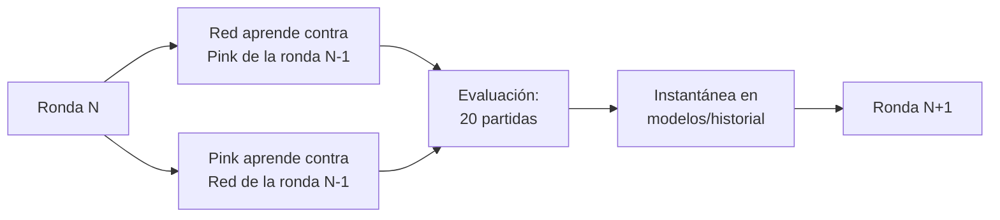
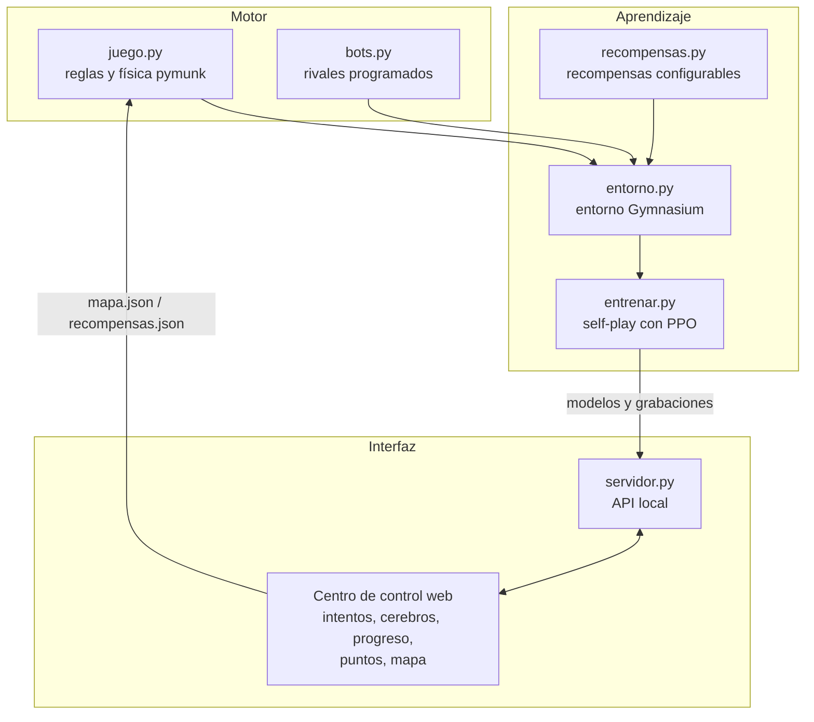

# Red vs Pink

**Dos agentes de aprendizaje por refuerzo que aprenden a combatir desde cero, sin instrucciones, solo a base de recompensas.**

Red vs Pink es un entorno multiagente en tiempo real con física 2D, visión parcial y objetos interactivos. Dos redes neuronales entrenadas con PPO compiten entre sí mediante *self-play*: cada una mejora enfrentándose a la versión más reciente de la otra. Nadie les explica qué es una escopeta, una caja o un veneno; lo descubren jugando.

El proyecto incluye un centro de control web local para lanzar y detener el entrenamiento, ver las partidas en directo, inspeccionar las neuronas de cada agente, ajustar las recompensas y editar el mapa, todo sin tocar código.


---

## Contenido

- [Características](#características)
- [Reglas del juego](#reglas-del-juego)
- [Cómo aprenden los agentes](#cómo-aprenden-los-agentes)
- [Arquitectura](#arquitectura)
- [Instalación](#instalación)
- [Uso](#uso)
- [Estructura del proyecto](#estructura-del-proyecto)
- [Stack tecnológico](#stack-tecnológico)
- [Hoja de ruta](#hoja-de-ruta)
- [Licencia](#licencia)

---

## Características

- **Self-play en paralelo con PPO.** Red y Pink entrenan a la vez, cada uno en su propio proceso, y en cada ronda se enfrentan a la versión que el rival guardó en la ronda anterior.
- **Física con pymunk.** Los jugadores tienen masa e inercia, chocan y se empujan. Las cajas se pueden empujar, lanzar y usar como cobertura, y los disparos producen retroceso.
- **Visión parcial.** Cada agente solo percibe lo que está dentro de su rango y campo de visión y sin obstáculos en medio. Lo que no ve, no lo sabe.
- **Objetos con mecánicas propias.** Escopeta con sobrecalentamiento, cajas sólidas y un veneno que se puede lanzar o beber.
- **Un tercer actor no entrenado.** Una víbora controlada por un algoritmo clásico (búsqueda en anchura) persigue a cualquiera que vea.
- **Posiciones iniciales aleatorias.** Un porcentaje configurable de partidas empieza con jugadores y objetos en lugares al azar, para que los agentes generalicen en vez de memorizar un único mapa.
- **Centro de control web.** Una interfaz local permite entrenar, observar e intervenir en tiempo real, y los cambios se aplican sin reiniciar el entrenamiento.
- **Interpretabilidad.** Un visor muestra, fotograma a fotograma, qué percibe cada agente, qué neuronas se activan y qué acción decide.
- **Historial completo.** Se guarda una instantánea de ambos agentes en cada ronda; el repositorio incluye las 146 rondas para ver su evolución.

---

## Reglas del juego

| Elemento | Descripción |
|---|---|
| **Objetivo** | Dejar al rival sin vidas. Cada jugador empieza con 2. |
| **Tiempo** | 20 segundos de partida a 30 ticks por segundo. Si se agota sin ganador, **pierden los dos**. |
| **Escopeta** | Dispara 5 perdigones en abanico con alcance de 7 casillas. Cada disparo la calienta; al llegar al máximo se suelta sola y hay que esperar a que se enfríe. |
| **Caja** | Objeto sólido que bloquea el paso y las balas. Se puede coger, soltar, empujar y lanzar. |
| **Veneno** | Lanzado, quita una vida al rival 3 segundos después del impacto. Bebido, mata al instante a quien lo bebe. |
| **Víbora** | Persigue al jugador más cercano que vea. Su mordida quita una vida y aguanta 20 perdigones. |
| **Visión** | Rango de 8 casillas y campo de 180 grados. Paredes y cajas bloquean la línea de visión. |

---

## Cómo aprenden los agentes

### Espacio de observación (66 valores normalizados)

| Grupo | Información |
|---|---|
| Propio | Posición, velocidad, vidas, orientación, objeto en mano, calor del arma, tiempo de recarga, estado de envenenamiento |
| Rival | Posición relativa, velocidad, vidas y objeto en mano (**solo si está a la vista**) |
| Objetos | Dirección hacia la caja, la escopeta y el veneno más cercanos que se vean |
| Entorno | Rejilla de 5x5 casillas alrededor con paredes y cajas |
| Víbora | Dirección, cercanía y vida de la víbora más cercana a la vista |
| Partida | Tiempo restante |

### Espacio de acciones (7 acciones discretas)

`quieto`, `arriba`, `abajo`, `izquierda`, `derecha`, `usar` (disparar o lanzar) y `coger/soltar` (o beber, si se lleva el veneno).

### Recompensas

La señal principal es escasa y está ligada al resultado: ganar, perder, quitar una vida o perderla. Sobre ella hay recompensas auxiliares pequeñas, como perseguir, apuntar bien o penalizar los choques contra paredes, que guían las primeras fases del aprendizaje. Todas se pueden ajustar en vivo desde el centro de control (pestaña *Puntos*), y los valores se guardan en `recompensas.json`.

### Bucle de entrenamiento



Cada agente es una política MLP de PPO (Stable-Baselines3) que toma una decisión cada 3 ticks, es decir, 10 veces por segundo. Los dos agentes entrenan simultáneamente en procesos separados, lo que casi duplica la velocidad frente a entrenarlos por turnos.

---

## Arquitectura



- **`juego.py`** contiene todas las reglas y no depende de gráficos ni de IA, así que puede simular miles de ticks por segundo.
- **`entorno.py`** adapta el juego a la interfaz estándar de Gymnasium (`reset`, `step`) desde el punto de vista de un agente.
- **`servidor.py`** usa solo la biblioteca estándar de Python y escucha únicamente en `127.0.0.1`.

---

## Instalación

Requisitos: Python 3.15 (es la versión con la que se ha probado) y Windows. El código del juego y del entrenamiento es multiplataforma; los lanzadores `.bat` y `.ps1` son específicos de Windows.

```bash
git clone https://github.com/FerDavalosHz/RED-VS-PINK.git
cd RED-VS-PINK
python -m venv venv
venv\Scripts\activate
pip install -r requirements.txt
```

Para comprobar la instalación:

```bash
python test_instalacion.py
```

---

## Uso

### Centro de control (recomendado)

Haz doble clic en `ABRIR_RED_VS_PINK.bat`, o ejecuta:

```bash
python servidor.py
```

Se abrirá `http://localhost:8765/` con cinco pestañas:

| Pestaña | Función |
|---|---|
| **Intentos** | Partidas del entrenamiento en directo, con selector de repeticiones y salto a la más reciente |
| **Cerebros** | Partida entre los agentes de cualquier ronda, mostrando sus neuronas en tiempo real |
| **Progreso** | Gráficas de victorias y de comportamientos descubiertos por ronda |
| **Puntos** | Ajuste en vivo de las recompensas, la visión y los tiempos de espera |
| **Mapa** | Editor visual de paredes, objetos y zonas de aparición |

### Desde la línea de comandos

```bash
python entrenar.py                          # entrenar (continúa desde la última ronda guardada)
python generar_visor.py --abrir             # grabar y ver una partida de los agentes actuales
python generar_visor.py --ronda 40 --abrir  # ver cómo jugaban en la ronda 40
```

Variables de entorno opcionales: `RVP_RONDAS` (número de rondas) y `RVP_PASOS` (decisiones por agente y ronda).

---

## Estructura del proyecto

```
RED-VS-PINK/
├── juego.py                  Motor: reglas, física y víbora
├── entorno.py                Entorno Gymnasium y observaciones
├── recompensas.py            Definición y carga de recompensas
├── entrenar.py               Entrenamiento por self-play
├── bots.py                   Rivales programados a mano
├── generar_visor.py          Graba una partida con la actividad neuronal
├── migrar_modelos.py         Adapta modelos guardados a nuevas observaciones
├── servidor.py               Servidor local del centro de control
├── centro.html               Interfaz principal
├── intentos.html             Repeticiones del entrenamiento
├── cerebros.html             Visualización de las redes neuronales
├── panel_entrenamiento.html  Gráficas de progreso
├── puntos.html               Editor de recompensas
├── editor_mapa.html          Editor de mapas
├── visor_plantilla.html      Plantilla del visor de partidas
├── visor.html                Partida de ejemplo ya generada
├── mapa.json                 Mapa actual
├── recompensas.json          Recompensas actuales
├── modelos/
│   ├── red.zip, pink.zip     Agentes entrenados más recientes
│   ├── historial/            Instantáneas de las 146 rondas
│   └── *.js / *.json         Datos de progreso y grabaciones para la interfaz
├── prueba_reglas.py          Pruebas de las reglas básicas
├── prueba_objetos.py         Pruebas de objetos y del entorno
└── test_instalacion.py       Verificación de dependencias
```

---

## Stack tecnológico

| Área | Herramienta |
|---|---|
| Aprendizaje por refuerzo | Stable-Baselines3 (PPO), Gymnasium |
| Redes neuronales | PyTorch |
| Física | pymunk (Chipmunk2D) |
| Cálculo numérico | NumPy |
| Interfaz | HTML, CSS y JavaScript sin dependencias, sobre Canvas 2D |
| Servidor | `http.server` de la biblioteca estándar de Python |

---

## Hoja de ruta

- Migración a un entorno 3D con Godot 4 y Godot RL Agents.
- Exportar la política entrenada a C para ejecutarla en un microcontrolador ESP32.
- Registro de métricas con TensorBoard.
- Mecánicas de altura: escaleras y zonas elevadas.

---

## Licencia

Distribuido bajo la licencia MIT. Consulta [LICENSE](LICENSE) para más detalles.
